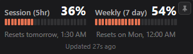
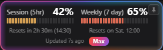

# Claude Usage Monitor (Compact UI)

**See your Claude usage at a glance, right from your system tray - and switch between Claude accounts in one click.**

A lightweight Windows tray app that watches your Claude rate limits for you. No dashboards to open, no commands to run - just a small icon that always shows how much of your session and weekly limits you have left, and a tiny popup with the details when you want them.

<p align="center"></p>

> **Note:** this build has only been tested on **Windows**. The original project it's based on also supports Linux, and most of that code is still here, but we haven't verified the newer features (the compact popup and account switching) on Linux ourselves yet.

---

## What's new in this version

This is a fork of the excellent [usage-monitor-for-claude](https://github.com/jens-duttke/usage-monitor-for-claude) by Jens Duttke, with a different popup design and a new feature on top:

- **A much smaller popup.** Instead of a full panel with account details, extra-usage breakdowns and installed versions, the popup is now just the usage bars - compact, pinnable, and draggable anywhere on screen so it can sit next to your editor while you work.
- **Auto-pin when Claude Code is active.** The popup notices when you're actively using Claude Code and pins itself automatically, so you don't have to re-open it every time.
- **Your plan at a glance.** A small **Pro** or **Max** badge in the footer shows which plan you're on. Max accounts also get a soft, animated glow around the popup.
- **Switch between Claude accounts from the tray menu.** If you use more than one Claude account (work and personal, for example), you can now save each one and switch the active login with a single click - no logging out, no browser re-authentication. Each saved account shows its own usage right in the menu, so you can see which one has headroom before you switch.

---

## Pro and Max badges

A **Pro** badge sits next to the status text. On a **Max** account the popup also gets a flowing, multicolor glow around its edge, so you can tell it's a Max account without reading anything.

<p align="center"></p>

**Click the Max badge to stop the animation.** The glow and the badge turn a calm, static Claude orange. Click it again to bring the animation back. The choice lasts until you close the popup. If your system is set to reduce motion, the glow never animates.

---

## Features

- **Portable** - a single EXE, no installer, no background service. Download it, run it, delete it when you're done.
- **Zero setup** - it reads the login you already have in Claude Code. Nothing to type in, no API key.
- **Live tray icon** with two progress bars, so you always know your usage without opening anything.
- **Compact, pinnable popup** - left-click the tray icon for the details: usage bars, reset countdowns, and extra-usage spending if that applies to your plan. Pin it and drag it wherever you like.
- **Multi-account switching** - save several Claude logins and switch between them from the tray menu, with each one's usage shown right there. (Windows only, see [below](#switching-between-claude-accounts).)
- **Smart alerts** - get a desktop notification when a quota is about to run out, or when it resets after being nearly empty.
- **Time marker** on every bar showing how far into the current period you are, so you can tell at a glance if you're using Claude faster than the clock is resetting.
- **Automatic token refresh** - if your login expires, the app quietly refreshes it in the background.
- **13 languages**, auto-detected from your system.
- **[Customizable](docs/configuration.md)** for anyone who wants to tweak colors, thresholds or polling speed - entirely optional.

---

## Switching between Claude accounts

If you work across multiple Claude accounts, the tray menu has a **Claude Accounts** entry:

1. Right-click the tray icon and open **Claude Accounts**.
2. The first time, it saves the account you're currently logged into automatically.
3. To add another account, choose **Add Account...** - this opens a console where you can log in to Claude Code with the other account, without touching your current login.
4. From then on, click any saved account in the menu to switch to it instantly. If Claude Code is busy running something, the switch waits until it's safe and happens automatically.

Your conversations and project history are never affected by switching - they're stored separately from your account login and are shared across all of them.

This feature is powered by a companion project, [ClaudeSwitch](https://github.com/sqasimhamdani/claudeswitch), which handles the account storage and switching safely (encrypted on disk, crash-safe, and aware of whether Claude Code is currently running).

---

## Is this safe to use?

This app needs your Claude login to check your usage, so you should be able to verify it isn't doing anything shady with it. A few things that make that easy:

- It only ever talks to `api.anthropic.com` - nowhere else.
- Your login token is only ever used to ask "what's my usage?" - never logged, saved elsewhere, or sent anywhere else.
- On Windows, the app itself writes no files to your disk. (If you use the account-switching feature, that part does save encrypted account snapshots - see [PRIVACY.md](PRIVACY.md) for exactly where and how.)
- No hidden or obfuscated code, no auto-updating itself, no telemetry.
- The source is small and readable - have a look for yourself.

Full details are in [PRIVACY.md](PRIVACY.md).

---

## Requirements

- Windows 10 or 11 (64-bit)
- [Claude Code](https://docs.anthropic.com/en/docs/claude-code) installed and logged in (CLI, VS Code extension, or JetBrains plugin - any of these work)

---

## Getting started

Check the [Releases](https://github.com/SQasimHamdani/claude-usage-monitor-compact-UI/releases) page for the latest build, download the `.exe`, and run it - no installation needed. To remove it later, just delete the file (turn off "Start at login" in the tray menu first if you'd enabled it).

Prefer to run it from source, or want to try the Linux build? See [Building from Source](#building-from-source) below.

---

## How to use it

| Action | What happens |
|---|---|
| **Hover** over the tray icon | Tooltip shows your usage percentages and reset times |
| **Left-click** the tray icon | Opens the usage popup |
| **Right-click** the tray icon | Menu: open popup, switch accounts, autostart, restart, GitHub link, quit |
| **Escape** or click outside the popup | Closes it |

### Tray icon not showing?

Windows sometimes hides new tray icons by default:

1. Right-click the **taskbar** → **Taskbar settings**
2. Expand **Other system tray icons** (Windows 11) or **Select which icons appear on the taskbar** (Windows 10)
3. Turn the app **On**

---

## Configuration

Everything works out of the box. If you'd like to tweak colors, alert thresholds, or polling speed, create a file called `usage-monitor-settings.json` next to the EXE (or in `~/.claude/`) with only the settings you want to change - see [Configuration](docs/configuration.md) for the full list.

---

## Building from Source

<details>
<summary>For developers</summary>

### Prerequisites

- Python 3.10+
- pip

### Setup

```bash
git clone https://github.com/SQasimHamdani/claude-usage-monitor-compact-UI.git
cd claude-usage-monitor-compact-UI
python -m venv .venv
.venv\Scripts\activate
pip install -r requirements.txt
```

The account-switching feature additionally needs the sibling [ClaudeSwitch](https://github.com/sqasimhamdani/claudeswitch) project checked out next to this one (`requirements.txt` installs it via a relative path until it's published to PyPI).

### Run

```bash
python -m usage_monitor_for_claude
```

### Test

```bash
python -m unittest discover -s tests
```

### Build the EXE

```bash
python build.py
```

Produces `dist/UsageMonitorForClaude.exe`.

### Linux

This project's platform layer still supports Linux (it runs from source against GTK/WebKit, same as the upstream project), but the newer compact-popup and account-switching features haven't been verified there yet by us. If you try it on Linux and run into issues, please [open an issue](https://github.com/SQasimHamdani/claude-usage-monitor-compact-UI/issues) - reports are very welcome.

</details>

---

## Contributing

Found a bug, or got an idea for a feature? [Open an issue](https://github.com/SQasimHamdani/claude-usage-monitor-compact-UI/issues) - reports, questions and pull requests are all welcome, whether you're a developer or just a user who ran into something odd.

<details>
<summary>For developers who want to contribute code</summary>

This project is developed with [Claude Code](https://docs.anthropic.com/en/docs/claude-code). The [`.claude/CLAUDE.md`](.claude/CLAUDE.md) file holds the project's conventions and architecture - Claude Code applies them automatically, and a human contributor should read it first too.

</details>

---

## License

MIT

---

## Disclaimer

This is an independent, community-built project, not created, endorsed, or officially supported by [Anthropic](https://www.anthropic.com/). "Claude" and "Anthropic" are trademarks of Anthropic, PBC, used here only to describe compatibility.
